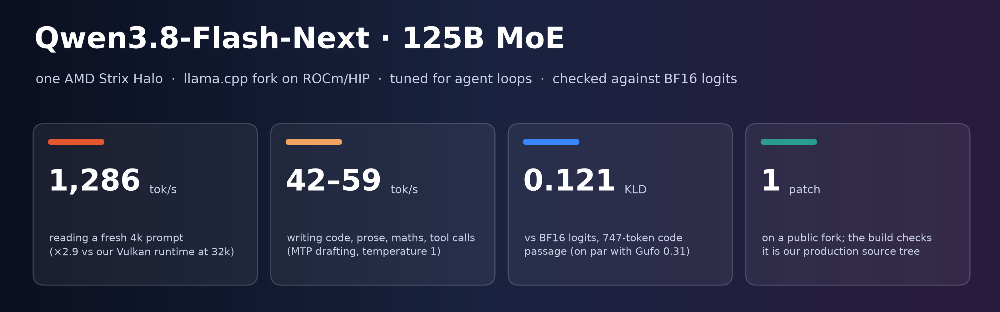
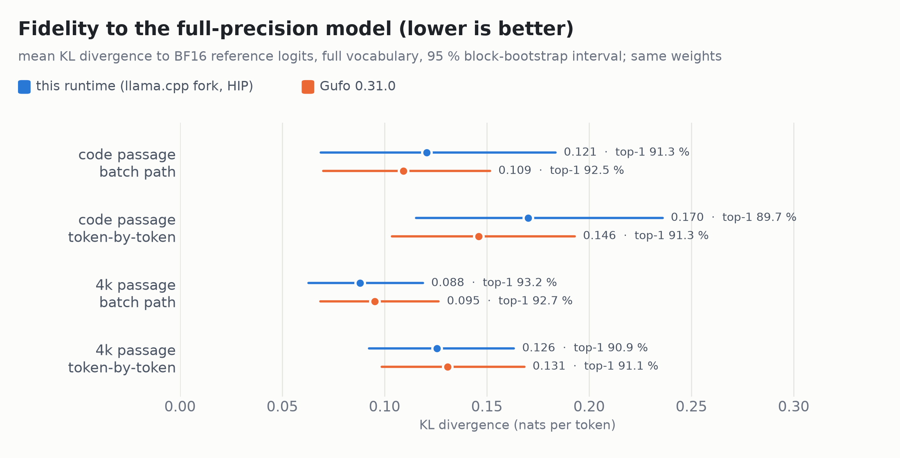

# strixhalo-verified



**Qwen3.8-Flash-Next** (125B MoE) on **one AMD Strix Halo box** (Ryzen AI Max+ 395, 128 GB unified memory), served by
**a llama.cpp fork on ROCm/HIP**, tuned for **local coding agents**, and **checked against BF16 reference logits**. 🧪
The model card has every measurement and its method:
🤗 [Kevletesteur/Qwen3.8-Flash-Next-StrixHalo-Verified](https://huggingface.co/Kevletesteur/Qwen3.8-Flash-Next-StrixHalo-Verified).

| | this runtime (8 Nov 2026) |
|---|---|
| 📖 reading a fresh prompt, 1k / 4k / 16k tokens | 783 / 1,286 / 1,516 tok/s |
| 🏎️ writing, agent settings (MTP drafting, temperature 1, reasoning xhigh) | 42–59 tok/s depending on the task |
| 📋 copying a file with two renames | 75–78 tok/s |
| 🎯 KL divergence vs BF16 logits (747-token code passage) | 0.121, same top-1 token 91.3 % |

🤝 **On the same box, [Gufo 0.31](https://github.com/gufo-org/gufo) is faster at the same quality.** Prefill is +54 %
at 1k, and decode is faster on most tasks. The card has the full comparison.

The first version of this repository (Vulkan runtime, 1 Oct 2026) is at tag
[`v1-vulkan`](https://github.com/AIdevsmartdata/strixhalo-verified/tree/v1-vulkan).

## 📦 What is here

| path | content |
|---|---|
| `runtime/patches/0001-strixhalo-hip-b29.patch` | the whole runtime delta, on top of [Aristo94/GSQHalo.cpp](https://github.com/Aristo94/GSQHalo.cpp) `5fc881b` |
| `runtime/COMMITS.md` | the 180 commits that make up that patch |
| `runtime/build.sh`, `runtime/cmake-options.txt` | clone, apply, **check the source tree hash**, build with the exact options of our production build (HIP, gfx1151) |
| `launch/qwen38-flash-next.sh` | the launcher, identical to our production launcher apart from paths, every environment switch commented |
| `launch/mtp_vocab_65k_fr4096.bin` | the 69,632 token ids scored by the MTP draft head |
| `bench/` | launcher parity check, agent-turn benchmark, tool-call speed probe |
| `CHANGELOG.md` | the main changes since August, with the measured effect of each |
| `THIRD_PARTY_NOTICES.md` | licences and credits for adapted code (Gufo, MIT) and data files |

Weights are not redistributed. You need:
- Unsloth's [UD-Q4_K_XL](https://huggingface.co/unsloth/Qwen3.8-Flash-Next-GGUF), merged into one file with
  `llama-gguf-split --merge`;
- `mmproj-F16.gguf` from the same repository;
- drluoto's [MTP draft head](https://huggingface.co/drluoto/Qwen3.8-Flash-Next-MTP-GGUF), `mtp-Qwen3.8-Flash-Next-Q4_K_M.gguf`.

## 🚀 Quick start

```bash
hf download unsloth/Qwen3.8-Flash-Next-GGUF --include "UD-Q4_K_XL/*" --include "mmproj-F16.gguf" --local-dir ~/models/qwen38
hf download drluoto/Qwen3.8-Flash-Next-MTP-GGUF mtp-Qwen3.8-Flash-Next-Q4_K_M.gguf --local-dir ~/models/qwen38

git clone https://github.com/AIdevsmartdata/strixhalo-verified && cd strixhalo-verified
ROCM_PATH=/opt/rocm ./runtime/build.sh      # ROCm with gfx1151 (7.14 measured), git, cmake, a C++17 compiler
./llama.cpp-strixhalo/build/bin/llama-gguf-split --merge \
  ~/models/qwen38/UD-Q4_K_XL/Qwen3.8-Flash-Next-UD-Q4_K_XL-00001-of-00004.gguf ~/models/qwen38/Qwen3.8-Flash-Next-UD-Q4_K_XL.gguf

MODEL=~/models/qwen38/Qwen3.8-Flash-Next-UD-Q4_K_XL.gguf \
MMPROJ=~/models/qwen38/mmproj-F16.gguf \
MTP=~/models/qwen38/mtp-Qwen3.8-Flash-Next-Q4_K_M.gguf \
MTP_IDS=$PWD/launch/mtp_vocab_65k_fr4096.bin \
RUNTIME=$PWD/llama.cpp-strixhalo/build/bin \
./launch/qwen38-flash-next.sh
```

Host settings we run with:
- kernel boot options `amd_iommu=off amdgpu.gttsize=112640 ttm.pages_limit=28835840 amdgpu.lockup_timeout=30000`
  (Ubuntu 26.04, kernel 7.0);
- the model file on a fast NVMe;
- at least 15 GB of RAM left free.

## 🔍 Check your setup

```bash
python3 bench/probe_tool_call_speed.py 8081 mine out/      # a module written as plain text, then inside a write() call
python3 bench/probe_agent_turns.py 8081 mine out/ 12 8000 fidele
```

## 🎯 Fidelity



Method, caveats and the paired comparison are on the
[model card](https://huggingface.co/Kevletesteur/Qwen3.8-Flash-Next-StrixHalo-Verified).

## 🙏 Credits

Qwen team · Unsloth · Aristo94 (GSQHalo.cpp) · halo-box/strix-llama.cpp contributors · llama.cpp and ggml maintainers ·
gufo-org/gufo (MIT, adapted code credited in the source) · drluoto (MTP heads) · nitinpanj (reference logits) ·
LaurentZuijdwijk (base of the Vulkan version).

Licence: MIT (see `LICENSE` and `THIRD_PARTY_NOTICES.md`). Author: Kévin Rémondière
([Hugging Face](https://huggingface.co/Kevletesteur), [GitHub](https://github.com/AIdevsmartdata)).
